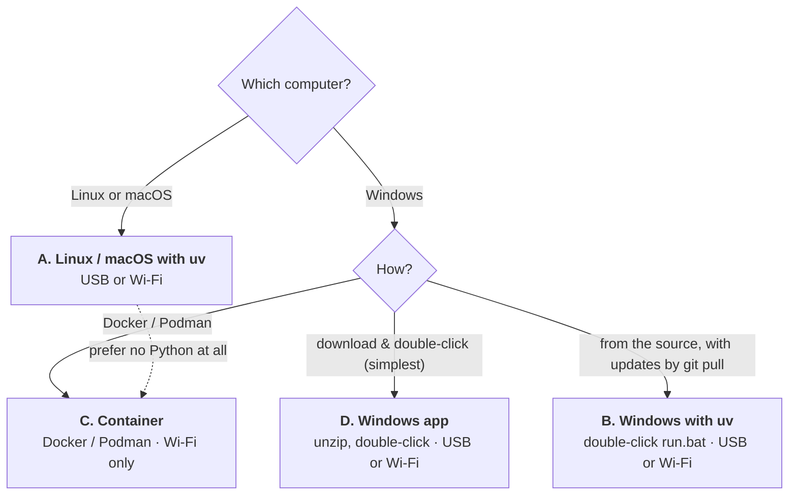

# android-instagram-tools

Tools that drive the **Instagram app on an Android phone** from a computer, over adb (with
[uiautomator2](https://github.com/openatx/uiautomator2)): they read the screen and tap and swipe
like a person would — no Instagram API, no browser.

| Tool | What it does | Status |
|---|---|---|
| **[feed_autoplay](#feed_autoplay-reference)** | plays the videos of your home timeline one after another, optionally at 2x, liking / reposting / copying links / saving them | the only tool so far |

> ⚠ Instagram's terms don't allow automated use. Acting at volume can get the account limited
> (Instagram already refused reposts after ~100 in under 2 hours). Use the tools at your own
> risk, with sensible settings.

---

## Choose how to run it



| | [A. Linux / macOS with uv](#a-linux-or-macos-with-uv) | [B. Windows with uv](#b-windows-with-uv) | [C. Container](#c-any-system-in-a-container-docker-or-podman) | [D. Windows app](#d-windows-download-the-app-nothing-to-install) |
|---|---|---|---|---|
| **You install** | uv (one command) | uv (one command) | Docker Desktop or Podman Desktop | nothing (unzip) |
| **Phone connection** | USB or Wi-Fi | USB (+ phone maker's driver) or Wi-Fi | Wi-Fi only | USB (+ phone maker's driver) or Wi-Fi |
| **Start** | `uv run feed_autoplay.py` | double-click `run.bat` | `docker compose run --rm app` | double-click `feed_autoplay.exe` |
| **Options** | on the command line | on the command line | `compose.yaml` / command line | `settings.txt` (Notepad) |
| **Best for** | everyday use on Linux/macOS | Windows, following the code (`git pull`) | no Python on the computer; same setup everywhere | Windows, the simplest |
| **Status** | tested on Linux; macOS expected to work | tested on Windows 11 (Wi-Fi); USB not yet tried | tested on Linux; not yet tried on Windows | tested on Windows 11, USB and Wi-Fi |

*USB is the more stable connection for long runs.* Whichever you choose, the tool, its options and
keys are the same — see the [feed_autoplay reference](#feed_autoplay-reference).

---

## A. Linux or macOS, with uv

**You need:** an Android phone with Instagram logged in, a Linux or macOS computer, and a USB cable
or the same Wi-Fi network. [uv](https://docs.astral.sh/uv/) sets up Python, the packages and adb
by itself on the first run (about a minute) — nothing else to install.

### 1. Prepare the phone

1. Settings → About phone → tap **Build number** 7 times (enables Developer options).
2. Developer options:
   - **USB debugging** on (for USB), and/or **Wireless debugging** on (for Wi-Fi; phone and
     computer on the same network);
   - **Stay awake** on (screen stays on while charging) — recommended for long runs.
3. Keep the phone **unlocked** with Instagram available. If it locks, the tools wait until you
   unlock it (they never try to unlock it themselves).
4. On first connection over USB, accept the "Allow USB debugging?" prompt on the phone.

### 2. Install (once)

```bash
curl -LsSf https://astral.sh/uv/install.sh | sh              # installs uv
git clone <repository URL> android-instagram-tools          # or download the zip and unzip it
cd android-instagram-tools
```

### 3. Connect the phone

- **USB:** plug it in — nothing else to do.
- **Wi-Fi:** pair once, then connect (IP & port from the phone's Wireless debugging screen):
  ```bash
  uv run tools/adb.py pair <pairing ip:port> <code>   # "Pair device with pairing code"
  uv run tools/adb.py connect <ip:port>
  uv run tools/adb.py devices                          # check: the phone shows as "device"
  ```

### 4. Run

```bash
uv run feed_autoplay.py --play all --2x                      # with keys: h help · s stats · q quit
```

**In the background** (keeps running after the terminal is closed):
```bash
mkdir -p runs
nohup uv run feed_autoplay.py --play all --2x < /dev/null >> runs/run.log 2>&1 &
tail -f runs/run.log                                          # follow it
touch runs/PAUSE                                              # pause: the phone is yours
rm runs/PAUSE                                                 # resume
touch runs/STOP                                               # stop it (or: kill <pid>)
```

Stopping always prints the final statistics. All options: `uv run feed_autoplay.py --help`.
**Update:** `git pull` — uv picks up new versions by itself on the next run.

---

## B. Windows, with uv

**You need:** an Android phone with Instagram logged in, a Windows computer, and a USB cable or the
same Wi-Fi network. [uv](https://docs.astral.sh/uv/) sets up Python, the packages and adb by
itself on the first run (about a minute) — nothing else to install, except the phone's USB driver
for USB.

### 1. Prepare the phone

1. Settings → About phone → tap **Build number** 7 times (enables Developer options).
2. Developer options:
   - **USB debugging** on (for USB), and/or **Wireless debugging** on (for Wi-Fi; phone and
     computer on the same network);
   - **Stay awake** on (screen stays on while charging) — recommended for long runs.
3. Keep the phone **unlocked** with Instagram available. If it locks, the tools wait until you
   unlock it (they never try to unlock it themselves).
4. On first connection over USB, accept the "Allow USB debugging?" prompt on the phone.

### 2. Install (once)

In a terminal (Windows Terminal / PowerShell):
```powershell
winget install --id astral-sh.uv                             # installs uv; then open a new terminal
git clone <repository URL> android-instagram-tools          # or download the zip and unzip it
cd android-instagram-tools
```
**For USB:** also install your phone maker's USB driver (Samsung: "Samsung Android USB Driver for
Windows").

### 3. Connect the phone

- **USB:** plug it in — nothing else to do.
- **Wi-Fi:** pair once, then connect (IP & port from the phone's Wireless debugging screen):
  ```powershell
  uv run tools/adb.py pair <pairing ip:port> <code>   # "Pair device with pairing code"
  uv run tools/adb.py connect <ip:port>
  uv run tools/adb.py devices                          # check: the phone shows as "device"
  ```

### 4. Run

**Double-click `run.bat`** — runs with the default settings. With options, from the terminal:
```powershell
.\run.bat --play all --2x                                     # with keys: h help · s stats · q quit
```

Stopping always prints the final statistics (the window stays open to read them). All options:
`.\run.bat --help`. **Update:** `git pull` (or download the zip again).

---

## C. Any system, in a container (Docker or Podman)

**You need:** an Android phone with Instagram logged in, **Docker Desktop** or **Podman Desktop**
(on Windows both set up WSL2 by themselves), and the phone and computer on the **same Wi-Fi
network**. No Python or adb on the computer. Works the same on Windows, Linux and macOS.

### 1. Prepare the phone

1. Settings → About phone → tap **Build number** 7 times (enables Developer options).
2. Developer options:
   - **USB debugging** on (for USB), and/or **Wireless debugging** on (for Wi-Fi; phone and
     computer on the same network);
   - **Stay awake** on (screen stays on while charging) — recommended for long runs.
3. Keep the phone **unlocked** with Instagram available. If it locks, the tools wait until you
   unlock it (they never try to unlock it themselves).
4. On first connection over USB, accept the "Allow USB debugging?" prompt on the phone.

The container reaches the phone over **Wireless debugging**: note the **IP address & Port** shown
on that screen.

### 2. Install (once)

In a terminal, after installing Docker Desktop or Podman Desktop:
```powershell
git clone <repository URL> android-instagram-tools          # or download the zip and unzip it
cd android-instagram-tools
copy .env.example .env                                       # Linux/macOS: cp .env.example .env
```
Edit `.env`: `PHONE=<IP:port from Wireless debugging>` and `TZ=<your time zone>` (e.g.
`Europe/Berlin`). Then build:
```powershell
docker compose build
```

### 3. Connect the phone (once)

On the phone, Wireless debugging → "Pair device with pairing code" (it shows *another* IP:port
and a code), then:
```powershell
docker compose run --rm app pair <pairing IP:port> <code>
```

### 4. Run

```powershell
docker compose run --rm app --play all --2x                  # with keys: h help · s stats · q quit
```

**In the background:**
```powershell
docker compose up -d                                          # start it (settings: "command:" in compose.yaml)
docker compose logs -f                                        # follow it
docker compose stop                                           # stop it
```
To use the phone meanwhile, create an empty file `runs/PAUSE` (Windows: `type nul > runs\PAUSE`)
to pause, and delete it to resume.

Stopping always prints the final statistics. All options: `docker compose run --rm app --help`.
With Podman, write `podman compose` instead of `docker compose`. **Update:** `git pull`, then
`docker compose build`. When the phone restarts, its Wi-Fi port changes: put the new one in
`.env`. More (saving the output, mirroring alongside, troubleshooting):
**[CONTAINER.md](CONTAINER.md)**.

## D. Windows, download the app (nothing to install)

**You need:** an Android phone with Instagram logged in, a Windows computer, and a USB cable or the
same Wi-Fi network. The app comes as a zip with everything inside (Python, the packages, adb) —
no uv, git or terminal needed.

### 1. Prepare the phone

1. Settings → About phone → tap **Build number** 7 times (enables Developer options).
2. Developer options:
   - **USB debugging** on (for USB), and/or **Wireless debugging** on (for Wi-Fi; phone and
     computer on the same network);
   - **Stay awake** on (screen stays on while charging) — recommended for long runs.
3. Keep the phone **unlocked** with Instagram available. If it locks, the tools wait until you
   unlock it (they never try to unlock it themselves).
4. On first connection over USB, accept the "Allow USB debugging?" prompt on the phone.

### 2. Download (once)

From the repository's **Releases** page, download `feed_autoplay-windows-<version>.zip` and
unzip it (e.g. to your Desktop). **For USB:** also install your phone maker's USB driver
(Samsung: "Samsung Android USB Driver for Windows").

### 3. Connect the phone

- **USB:** plug it in — nothing else to do.
- **Wi-Fi:** double-click **`connect.bat`** in the folder. It asks for the pairing IP & port
  and code ("Pair device with pairing code", needed once), then for the IP & port at the top of
  the Wireless debugging screen, and tells you when the phone is ready.
- **Done for now:** double-click **`disconnect.bat`**. It ends the connections and stops adb,
  which otherwise keeps running in the background (`adb.exe`) after the app ends. The pairing
  stays; to remove the computer for good: on the phone, Wireless debugging → Paired devices →
  tap it → Forget.

### 4. Run

**Double-click `feed_autoplay.exe`.** The first time, Windows may say "Windows protected your
PC": **More info → Run anyway** (the app isn't signed with a paid certificate). On its first
start it creates **`settings.txt`** next to it with the app's default settings (play all · 2x · like all · repost all · copy link all · save all) — open it
with Notepad to change them (put a `#` in front of an option to turn it off). An update doesn't
change an existing `settings.txt`. Keys work in its window (**h** help · **s**
stats · **q** quit); it stays open at the end so you can read the statistics.

**Update:** run `disconnect.bat`, then unzip the new version over the old folder —
`settings.txt` and `runs` are kept. More (troubleshooting, options): `README.txt` in the folder.

---

## feed_autoplay reference

Plays the videos of your **Instagram home timeline**, one after another, without you touching the
phone — so a mirrored phone (e.g. scrcpy on a second screen) is always playing something.
Optionally at **2x**, and it can **like**, **repost**, **copy the link of** and/or **save** each
video it watched to the end. The same options and keys apply in A, B, C and D.

### Options

| Option | Values (default in bold) | What it does |
|---|---|---|
| `--play` | **followed** · all | play only videos from accounts you follow, or every video |
| `--2x` | (off) | play each video at 2x speed (key **x** switches it during the run) |
| `--like` | none · **followed** · all | like the videos watched to the end |
| `--repost` | **none** · followed · all | repost them (shown on your profile) |
| `--share-link` | **none** · followed · all | Share → Copy link; links collected in `runs/shared-links.txt` |
| `--save` | **none** · followed · all | save them to your private Saved collection |
| `--max-watch S` | **300** | stop watching a video after S seconds |

"followed" = only for accounts you follow. Actions happen only for videos watched to the end, in
the order of the buttons on screen (like → repost → share → save), and never twice: a post
already liked/reposted/saved is left alone. Example:
`--play all --2x --like all --repost followed`

### Keys

| Key | | Key | |
|---|---|---|---|
| **n** | next video | **l** | like mode |
| **p** | pause (the phone is yours) / resume | **r** | repost mode |
| **x** | 2x on / off (from the next video) | **c** | copy-link mode |
| **w** | play mode | **b** | save mode |
| **s** | statistics | **h** / **?** | help |
| | | **q** | quit |

Keys work when the tool runs in a terminal window, not in the background.

**Using the phone in between:** press **p** (in the background: create `runs/PAUSE`), use the
phone as you like, then press **p** again (delete the file). While paused the tool doesn't touch the phone at all. On resume it carries
on with the same video if you left it untouched; otherwise it leaves that video (no like etc.)
and continues from the Home feed. Paused time doesn't count in the statistics' pace.

### What it shows

At start: the phone, the Instagram version and the settings. While running: one line per video
and action (`▶` opened, `⏩` 2x, `♥` liked, `🔁` reposted, `🔗` link, `🔖` saved). Every 20
videos (and on **s** / when stopping) a statistics block, including the **pace** — how many
videos an hour to expect. Files go to `runs/`: copied links (`shared-links.txt`) and diagnostics
of videos that hit the time limit (`maxwatch-*.npz`).

### Good to know

- **Instagram limits reposts.** After many reposts it answers "Unable to repost"; the tool
  notices, doesn't count it, and pauses reposting (30 min, longer if it repeats).
  `--repost followed` is much gentler than `all`.
- **Tested on** a Samsung Galaxy phone (Android 11, 1080×2340 screen) with Instagram 451, in
  **English** (UK and US) and **Brazilian Portuguese** (Instagram's app language; the phone's own language
  doesn't matter). Another phone, screen size, Instagram version or language may need adjustments — it
  warns at startup when the Instagram version is one it wasn't tested with.
- **Wi-Fi debugging:** the phone's port changes when wireless debugging is switched on again or
  the phone restarts; reconnect with the new one.
- The beginning of each video (~10 s) is usually missed: Instagram starts it in the feed before
  the tool opens it.
- **Mirroring (optional):** [scrcpy](https://github.com/Genymobile/scrcpy) shows the phone on
  the computer — Linux `apt install scrcpy` or `snap install scrcpy`, macOS `brew install scrcpy`,
  Windows: the zip from its releases page. The tools don't need it.

---

## Privacy

The `runs/` folder (run logs with the accounts that were played, your copied links,
diagnostics) and `.env` (your phone's address) are personal — `.gitignore` keeps them out of the
repository. So is the **tuning data** (`tools/traces*/`, `tools/icon_samples/`): screenshots of
a real feed, used only to tune the tools and kept off the repository — record your own with
`tools/record_traces.py` if you need them (DEVELOPMENT.md 5).

## More

- **[CONTAINER.md](CONTAINER.md)** — running in Docker/Podman, step by step.
- **[DEVELOPMENT.md](DEVELOPMENT.md)** — how the tools work, the decisions behind them, what was
  tested, naming and project layout, and how to change things.
